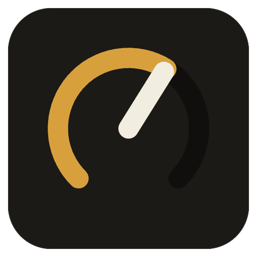
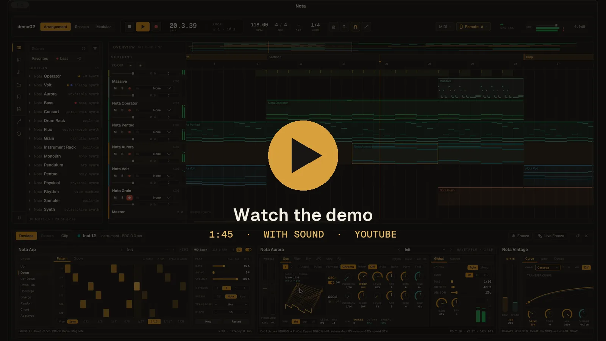
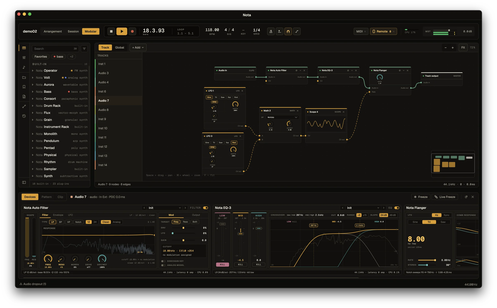
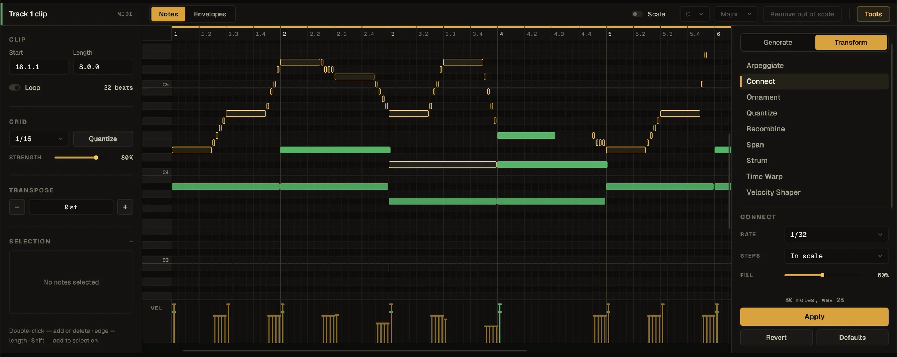
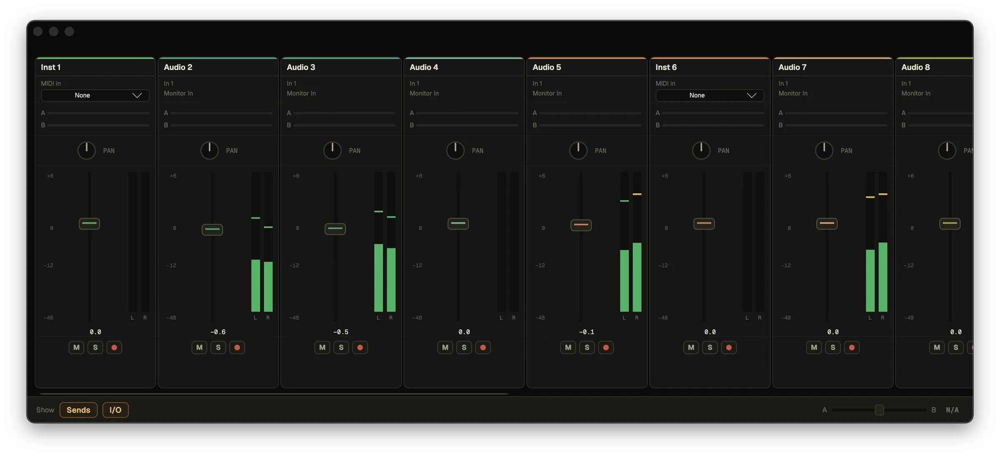
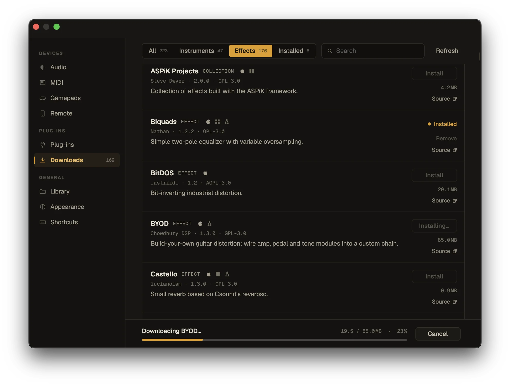
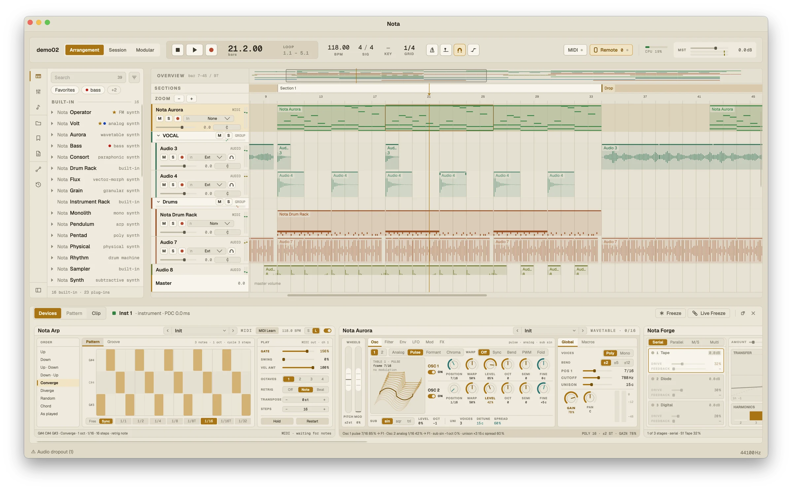

<p align="center">
  
</p>

<h1 align="center">Nota</h1>

<p align="center">
  <b>A free music studio for macOS, Windows and Linux.</b><br>
  No subscription, no account, no feature tiers — just open it and make music.
</p>

<p align="center">
  <a href="https://github.com/nota-daw/nota/releases/latest"></a>
  &nbsp;
  <a href="https://nota-daw.github.io/nota-site/"></a>
  &nbsp;
  <a href="https://discord.gg/apf4Q2JKWk"></a>
</p>

<p align="center">
  <a href="https://github.com/nota-daw/nota/releases/latest"></a>
  <a href="https://github.com/nota-daw/nota/actions/workflows/release.yml"></a>
  <a href="https://github.com/nota-daw/nota/releases"></a>
  <a href="LICENSES/"></a>
  
  <a href="https://nota-daw.github.io/nota-docs/"></a>
</p>


<p align="center">▶ <a href="https://www.youtube.com/watch?v=zmvKOCIm4ig"><b>Watch the demo with sound</b></a> (1:45, YouTube)</p>

## Why Nota

- **Free, for good.** Open source, no paid edition, no "upgrade to unlock".
- **Arrange and jam.** A linear **Arrangement** timeline and a clip-launching **Session**
  grid, with material moving freely between them — plus a **Modular** view for patching
  modulation by cable.
- **A full kit out of the box.** ~35 built-in instruments and effects: subtractive,
  wavetable, FM, granular and physical-modelling synths, a drum machine, EQ, compressors,
  reverbs, delays, saturation, arpeggiator, chord and scale tools, racks with macros.
- **Your plugins too.** VST3 on every platform, Audio Units on macOS. Popular free plugins
  (Surge XT, Dexed, Dragonfly Reverb …) install in one click from Settings.
- **Your phone is a controller.** Scan a QR code and play pads, keys and an XY pad, or ride
  the mixer — over Wi-Fi or USB, nothing to install.
- **Easy on the eyes.** A calm Studio look: neutral greys, one orange accent for what is
  playing or chosen. Dark or light, or the warm Ember themes, and your phone follows along.
- **Works where you do.** The same app on macOS, Windows and Linux, on Intel/AMD and ARM.

## Demo

<a href="https://www.youtube.com/watch?v=zmvKOCIm4ig"></a>

## Screenshots

<table>
  <tr>
    <td width="50%"><br><sub><b>Arrangement</b> — the song, with the selected track's devices below</sub></td>
    <td width="50%"><br><sub><b>Modular</b> — patch LFOs and modulators onto any parameter</sub></td>
  </tr>
  <tr>
    <td width="50%"><br><sub><b>Piano roll</b> — draw, then arpeggiate, strum or ornament in one click</sub></td>
    <td width="50%"><br><sub><b>Built-in devices</b> — every one draws what it does to the sound</sub></td>
  </tr>
  <tr>
    <td width="50%"><br><sub><b>Mixer</b> — faders, sends and live meters</sub></td>
    <td width="50%"><br><sub><b>Downloads</b> — 200+ free open-source plugins, one click to install</sub></td>
  </tr>
  <tr>
    <td width="50%"><br><sub><b>Studio Light</b> — the same look in light greys, for daytime sessions</sub></td>
    <td width="50%"><br><sub><b>Colour themes</b> — Studio or Ember, dark or light, or follow the system</sub></td>
  </tr>
</table>

## Features

A quick digest — see [`FEATURES.md`](FEATURES.md) for the full, categorised list.

- **Three views** — **Arrangement** timeline, **Session** clip grid, and a **Modular**
  signal-graph editor with **CV modulation** (LFO / envelope follower / MIDI→CV / ADSR /
  Macro / Math, patched onto any parameter).
- **Tracks & mixer** — audio, MIDI, group (nestable), return and master tracks; sends;
  MIDI routing between tracks; peak/RMS and true-peak meters.
- **MIDI** — piano roll with quantize and velocity; play from a MIDI keyboard, the computer
  keyboard, a **gamepad** (macOS) or your **phone**; drag in `.mid` files; turn audio into
  MIDI (melody / harmony / drums / slice).
- **Audio** — record from inputs and internal buses; import WAV/AIFF/FLAC/MP3; fades, gain
  and per-clip envelopes; **warp / time-stretch**.
- **Automation & MIDI Learn** — draw or record automation on any parameter; map hardware
  knobs to almost anything.
- **Browser** — preview presets, drum kits, effects and samples before you load them.
- **Version history** — every save is kept; go back to any earlier version of a song, or
  branch off from it.
- **Export** — the master or stems to WAV (16/24-bit or 32-bit float), with true-peak
  normalize and dither.
- **Colour themes** — **Studio Dark** (the default), **Studio Light**, **Ember Graphite** and
  **Ember Paper**; pick one, or follow the system's dark / light mode. Nota Remote on your
  phone wears the same theme.
- **AI control (optional)** — a local MCP server lets an AI assistant such as Claude work
  in the open project. Off by default.

## Install

Download the file for your system from the
**[latest release](https://github.com/nota-daw/nota/releases/latest)**:

| System | File | Notes |
|---|---|---|
| **macOS 13+**, Apple Silicon (M1 and later) | `Nota-<version>-arm64.dmg` | |
| **macOS 13+**, Intel | `Nota-<version>-x86_64.dmg` | |
| **Windows 10/11**, most PCs | `Nota-Setup-<version>-x64.exe` | |
| **Windows 11** on ARM | `Nota-Setup-<version>-arm64.exe` | |
| **Linux**, most PCs | `Nota-<version>-x86_64.AppImage` | |
| **Linux** on ARM | `Nota-<version>-aarch64.AppImage` | |

### First launch

Nota isn't signed with a paid Apple or Microsoft certificate yet, so the system asks you to
confirm the first time:

- **macOS** — see [Opening Nota on macOS](#opening-nota-on-macos) below.
- **Windows** — if SmartScreen shows "Windows protected your PC", click **More info →
  Run anyway**.
- **Linux** — make the AppImage executable (`chmod +x Nota-*.AppImage`, or Properties →
  Permissions in your file manager) and run it.

### Opening Nota on macOS

1. Open the downloaded `.dmg` and drag **Nota** into **Applications**.
2. Open Nota from Applications. The first time, macOS stops it with
   *"Nota" Not Opened — Apple could not verify "Nota" is free of malware…*
   (older macOS: *"Nota" can't be opened because Apple cannot check it for malicious
   software*). Click **Done** — not *Move to Trash*.
3. Open **System Settings → Privacy & Security** and scroll down to **Security**. You'll see
   *"Nota" was blocked to protect your Mac*. Click **Open Anyway**, confirm with your
   password or Touch ID, then click **Open Anyway** once more.

That's it — from now on Nota opens like any other app.

<details>
<summary>Still won't open, or macOS says Nota "is damaged"?</summary>

That message is the same check with scarier wording — the download isn't actually broken.
Open **Terminal** (Applications → Utilities) and run:

```bash
xattr -dr com.apple.quarantine /Applications/Nota.app
```

This removes the "downloaded from the internet" mark from Nota only. Then open Nota
normally.

On **macOS 13–14** there's also a shortcut for step 3: in Finder, **right-click** (or
Control-click) Nota in Applications → **Open** → **Open**.
</details>

Why the extra step? Signing an app so macOS trusts it right away needs a paid Apple
developer certificate, which Nota doesn't have yet. Nota is open source and built in public by
GitHub Actions from the code in this repository.

Nota checks for updates itself and shows what's new after each update.

## Status

New to Nota? The [user manual](https://nota-daw.github.io/nota-docs/) (English and Russian)
walks through every view and device.

Nota is young and moving fast — new releases come out every week or so (see the
[changelog](CHANGELOG.md)). It's already used to make real music, but expect rough edges.
Found a bug or missing something? [Open an issue](https://github.com/nota-daw/nota/issues/new/choose) —
every report gets read. Want to help with code? Start with a
[good first issue](https://github.com/nota-daw/nota/issues?q=is%3Aissue+is%3Aopen+label%3A%22good+first+issue%22).
Development here is spec-driven: non-trivial changes start as a written spec in
[`specs/`](specs/) — requirements, plan and tasks before any code — following the
[Spec Kit](https://github.com/github/spec-kit)
[workflow](CONTRIBUTING.md#spec-driven-workflow) in [`CONTRIBUTING.md`](CONTRIBUTING.md).
Questions, ideas or music to share? Join the [Discord server](https://discord.gg/apf4Q2JKWk).

## For plugin developers

Nota has its own plugin registry —
**[nota-daw/nota-plugins-registry](https://github.com/nota-daw/nota-plugins-registry)** —
the list of open-source VST3 plugins that Nota installs from **Settings → Downloads**.
Add yours with a pull request and every Nota user can install it in one click; the
registry's [README](https://github.com/nota-daw/nota-plugins-registry#readme) explains
what gets in and how.

## Building from source

The audio engine and DSP are a portable C++20 core; the UI is .NET 10 / Avalonia 12 (C#);
plugin hosting runs through JUCE, isolated in its own module so the engine core stays
JUCE-free.

```bash
git clone --recurse-submodules https://github.com/nota-daw/nota.git
cd nota
scripts/build.sh            # Build on macOS.
scripts/build-linux.sh      # Build on Linux.
scripts/build-win.ps1       # Build on Windows.
dotnet run --project src/managed/Nota.App
```

- [`BUILD.md`](BUILD.md) — prerequisites per platform, manual builds, packaging installers
  and AppImages.
- [`ARCHITECTURE.md`](ARCHITECTURE.md) — how the engine, the C ABI and the app fit together.
- [`CONTRIBUTING.md`](CONTRIBUTING.md) — contributing, licensing your work, and the
  real-time rules.
- [`specs/`](specs/) — the spec-driven development workflow for non-trivial changes;
  see [`CONTRIBUTING.md`](CONTRIBUTING.md#spec-driven-workflow) and the worked example
  in [`specs/000-example/`](specs/000-example/).

## About

Nota is made by **Egor Khindikaynen** aka **Ambertape**
([music](https://soundcloud.com/ambertape)). It started as a tool I built for my own
music and was later opened up as open source. Most of the code was written with AI
assistance, with every design decision, the sound and the workflow guided and shaped
by me.

## License

Licensed under **AGPL-3.0-only** — see [`LICENSES/`](LICENSES/) for the terms, and
[`LICENSES/third-party.md`](LICENSES/third-party.md) for the dependency register.

Nota links JUCE, which is AGPLv3, so the open build is AGPL rather than GPL — see
[`LICENSES/README.md`](LICENSES/README.md#why-agpl-and-not-gpl).
