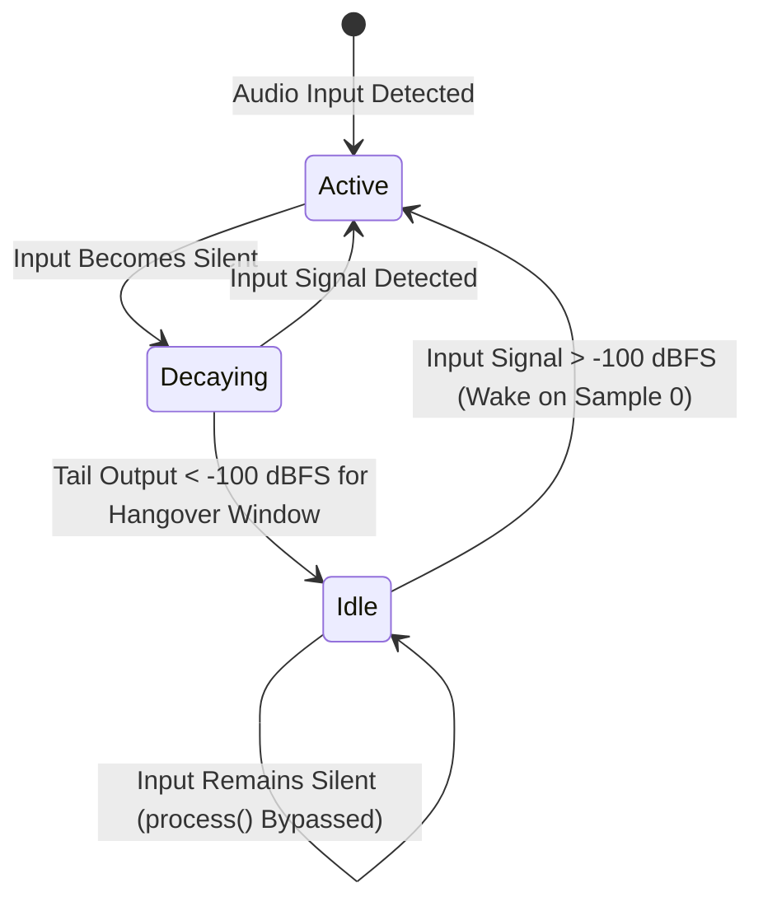

# Phase 0 Research: DSP Silence Detection & Dynamic Sleep Bypass

## 1. Technical Formulation & Performance Architecture

### Problem Analysis
In Nota sessions, projects frequently scale to 20–60 tracks and dozens of insert plugins. However, in typical song arrangements:
- At any given beat, 70–85% of tracks are silent (waiting for arrangement clips or MIDI note-ons).
- In traditional naive audio engines, every track and effect device continuously evaluates its full DSP inner loop on blocks of zeros or subnormal floating point noise.
- This results in high idle CPU utilization (15–30% baseline CPU on an empty or sparse session) and prevents lower buffer sizes without audio dropouts.

### Silence Detection Algorithm
A high-throughput, early-exiting silence detection function is required.
```cpp
inline bool isBufferSilent(const float* interleaved, int32_t frames, float threshold = 1.0e-5f) {
    const int32_t count = frames * 2;
    for (int32_t i = 0; i < count; ++i) {
        if (std::fabs(interleaved[i]) > threshold) return false;
    }
    return true;
}
```
**Complexity & Characteristics**:
- **Best Case (Audio Present)**: Early exit on the first non-zero sample ($O(1)$, 1–3 CPU cycles).
- **Worst Case (Pure Silence)**: $O(N)$ sequential memory scan. For a 512-sample stereo buffer (1024 floats, 4 KB), the scan sits in L1 cache and completes in $< 100$ ns.
- **Threshold**: $1.0 \times 10^{-5}$ represents $-100\text{ dBFS}$. Anything below this is inaudible and within DAC/ADC analog noise floors.
- **Denormals**: With `ScopedNoDenormals` active (FTZ/DAZ enabled), subnormals flush to zero, preventing false wake triggers.

---

## 2. Sleep Lifecycle & State Machine

Every effect device operates under a 3-phase lifecycle:



1. **`Active`**: Input signal is present. The device executes its full DSP pipeline. Output is monitored.
2. **`Decaying`**: Input signal is silent ($< 10^{-5}$), but the internal state (delay buffer, reverb tank, compressor release envelope) is still discharging acoustic energy. Output continues to render.
3. **`Idle`**: Output has remained below $-100\text{ dBFS}$ for at least the **hangover window** (default: 50 ms / ~2200 samples). The device sets `idle_ = true`. On subsequent silent blocks, `process()` immediately returns without touching floating-point registers.

### Hangover Window Rationale
- Low-frequency signals (e.g. 40 Hz sub-bass) have a period of $T = 25\text{ ms}$. A zero-crossing can span several consecutive samples near zero.
- A 50 ms hangover window guarantees that zero-crossings and brief pauses in speech or musical phrasing never prematurely trigger sleep.

---

## 3. Device Classification

| Device | Category | Tail Mechanism | Hangover / Sleep Policy |
| :--- | :--- | :--- | :--- |
| `Delay` | Time-based | Delay line recirculating feedback | Decays until feedback tail $< -100\text{ dBFS}$ for 50 ms. Freeze mode disables sleep. |
| `Chamber` / `Reverb` | Time-based | FDN reverb tank & diffusion | Decays until tank energy $< -100\text{ dBFS}$ for 100 ms. Infinite/freeze decay disables sleep. |
| `Compressor` | Dynamics | Envelope detector release | Enters sleep when envelope follower reaches noise floor and gain reduction is 0 dB. |
| `Ceiling` | Limiter | Lookahead buffer & limiter gain | Lookahead buffer must drain before entering sleep. |
| `Eq` | Filter (IIR) | Biquad Direct Form II Transposed | IIR filter states decay exponentially ($< 10^{-7}$ in ~5 ms). Once states are zero, immediately idle. |
| `AutoPan` | Modulation | Stateless waveshaping | $0.0 \times \text{gain} = 0.0$. Immediately idle on silent input. |
| `Vintage` | Saturator | Waveshaper / saturation curve | DC-corrected output is 0 for 0 input. Immediately idle on silent input. |
| `Utility` | Math / Gain | Stateless | Immediately idle on silent input. |

---

## 4. Track-Level Bypass in `mixGraph()`

In `Engine_Render.cpp`:
1. When evaluating a track:
   - Check if instrument / audio clip / monitor raw rendering produced silence.
   - If silent, check whether all devices in `track.devices` report `d->isIdle()`.
   - If all devices are idle and track is silent:
     - Set track meter atomic to 0.
     - Skip insert chain iteration.
     - Skip PDC delay line processing.
     - Skip post-fader send bus additions.
2. If any device has a ringing tail, continue rendering the insert chain into `scratch_` until all devices transition to `Idle`.

---

## 5. Architectural & Safety Principles (AR-6)

- **Zero Allocations**: State machine variables (`idle_`, `tailCountdown_`) are embedded directly in device structs as primitive integers/booleans.
- **Zero Locks**: Audio thread owns sleep state transitions during `process()`. UI reads are lock-free or read atomic telemetry.
- **Instant Wakeup**: Waking occurs synchronously on sample 0 of the first block where `!isBufferSilent`. There is zero latency, zero crossfades on onset, and zero missing transients.
